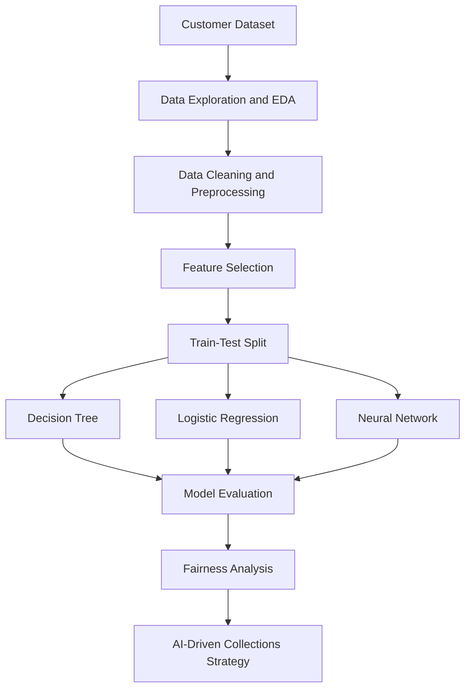

# AI-Driven Customer Delinquency Prediction

<p align="center">

**An End-to-End Machine Learning Project for Credit Risk Analysis**

</p>

<p align="center">


</p>

## 1. Project Overview

Customer delinquency is an important challenge in the banking and financial services industry. Identifying customers who may miss their payments can help financial institutions understand credit risk and develop more effective collection strategies.

This project explores customer delinquency prediction using exploratory data analysis, data preprocessing, and three machine learning algorithms.

It also examines model performance, evaluates differences across age groups, and proposes an AI-driven collections strategy with human oversight and responsible AI principles.

## 2. Project Objectives

- Analyze customer financial data to identify potential delinquency indicators.
- Perform exploratory data analysis (EDA) to understand dataset patterns.
- Prepare data for machine learning.
- Develop and compare three predictive models.
- Evaluate models using multiple classification metrics.
- Examine fairness across different customer age groups.
- Propose an AI-driven collections strategy based on responsible AI principles.

## 3. Dataset Information

| Attribute | Details |
|---|---|
| Dataset size | 500 records |
| Number of features | 19 columns |
| Target variable | `Delinquent_Account` |
| Non-delinquent accounts | 420 (84%) |
| Delinquent accounts | 80 (16%) |
| Training data | 400 records |
| Testing data | 100 records |

**Selected prediction features:**

- Income
- Credit Utilization
- Debt-to-Income Ratio
- Missed Payments

**Target variable:** `Delinquent_Account`

- `0` – Non-delinquent account
- `1` – Delinquent account

## 4. Machine Learning Workflow

The project follows the workflow below:



## 5. Exploratory Data Analysis

Exploratory data analysis was performed to understand the dataset, examine missing values, identify data patterns, and study the distribution of delinquent accounts.

Key areas examined:

- Dataset structure and statistical summaries.
- Missing values and duplicate records.
- Distribution of delinquent and non-delinquent accounts.
- Relationships between numerical variables.
- Financial indicators associated with customer delinquency.

## 6. Machine Learning Models

Three classification algorithms were implemented:

| Model | Purpose |
|---|---|
| Decision Tree | Identifies decision rules and patterns in customer data. |
| Logistic Regression | Estimates the likelihood of customer delinquency. |
| Neural Network | Learns more complex relationships between input features. |

All three models were trained using the same selected features and evaluated on the test dataset.

## 7. Model Performance Comparison

The following results were obtained from the model evaluation:

| Evaluation Metric | Decision Tree | Logistic Regression | Neural Network |
|---|---:|---:|---:|
| Accuracy | 46% | 47% | 73% |
| Precision | 13.5% | 10.6% | 7.7% |
| Recall | 43.8% | 31.2% | 6.2% |
| F1 Score | 20.6% | 15.9% | 6.9% |
| AUC-ROC | 0.465 | 0.423 | 0.427 |

### Model Performance Visualization

```mermaid
xychart-beta
    title "Model Performance Comparison"
    x-axis ["Decision Tree", "Logistic Regression", "Neural Network"]
    y-axis "Score (%)" 0 --> 100
    bar [46, 47, 73]
    bar [13.5, 10.6, 7.7]
    bar [43.8, 31.2, 6.2]
```



*The three bar series represent accuracy, precision, and recall, respectively.*

### Key Observations

- The Neural Network achieved the highest accuracy at 73%, but its delinquency recall was only 6.2%.
- The Decision Tree achieved the highest recall at 43.8% among the three models.
- All models showed weak discrimination performance, with AUC-ROC scores below 0.5.
- Accuracy alone does not provide a reliable picture of performance because the dataset contains an imbalanced target variable.

**Important:** The current models are experimental and should not be used for real-world credit decisions without further development and validation.

## 8. Fairness Analysis

A fairness analysis was performed using the Decision Tree model to examine differences in predictions across customer age groups.

| Age Group | Customers | Predicted High Risk | Recall | False Positive Rate |
|---|---:|---:|---:|---:|
| 18–29 | 24 | 62.50% | 60.00% | 63.16% |
| 30–44 | 26 | 42.31% | 25.00% | 45.45% |
| 45–59 | 20 | 50.00% | 0.00% | 50.00% |
| 60–74 | 30 | 53.33% | 42.86% | 56.52% |

### Fairness Observations

- Prediction rates differed across age groups.
- Recall and false positive rates were not consistent across groups.
- These differences indicate the need for further fairness evaluation.
- The observed differences alone do not establish discrimination or prove that the model is biased.

## 9. AI-Driven Collections Strategy

Based on the analysis, an AI-driven collections strategy is proposed to support more structured customer engagement.

The proposed approach includes:

1. **Customer Risk Assessment:** Analyze relevant customer financial indicators.
2. **Decision Engine:** Categorize customers according to predicted risk.
3. **Automated Engagement:** Send appropriate payment reminders for low-impact situations.
4. **Human Oversight:** Escalate disputes, financial hardship cases, exceptions, and high-impact decisions for human review.
5. **Continuous Monitoring:** Evaluate outcomes, model performance, and fairness over time.

The proposed strategy emphasizes explainability, customer privacy, fairness, regulatory compliance, and human accountability.

*This is a proposed business strategy, not a deployed autonomous collections system.*

## 10. Technologies Used

| Technology | Application |
|---|---|
| Python | Programming language |
| Pandas | Data manipulation and analysis |
| NumPy | Numerical operations |
| Matplotlib | Data visualization |
| Scikit-learn | Machine learning and evaluation |
| Jupyter Notebook | Development and experimentation |
| GitHub | Project version control and documentation |

## 11. Repository Structure

```text
AI-Driven-Customer-Delinquency-Prediction/
│
├── Notebooks/
│   ├── customer_delinquency_prediction.ipynb
│   ├── fairness_analysis_results.csv
│   └── model_evaluation_results.csv
│
├── data/
│   └── Delinquency_prediction_dataset.csv
│
├── reports/
│   └── Geldium_AI_Collections_Strategy.md
│
├── .gitignore
├── LICENSE
└── README.md
```

## 12. How to Run the Project

**Step 1:** Clone the repository.

```bash
git clone https://github.com/YOUR-USERNAME/AI-Driven-Customer-Delinquency-Prediction.git
```

**Step 2:** Navigate to the project directory.

```bash
cd AI-Driven-Customer-Delinquency-Prediction
```

**Step 3:** Install the required libraries.

```bash
pip install pandas numpy matplotlib scikit-learn openpyxl jupyter
```

**Step 4:** Launch Jupyter Notebook.

```bash
jupyter notebook
```

**Step 5:** Open `Notebooks/customer_delinquency_prediction.ipynb` and execute the cells in sequence.

## 13. Limitations

- The dataset contains only 500 records.
- The target variable is imbalanced.
- All three models demonstrated weak delinquency discrimination.
- Fairness results are based on a limited test sample.
- Further feature engineering, data collection, model tuning, and validation are required.

The results should be interpreted as an experimental analysis rather than a production-ready credit risk prediction system.

## 14. Future Improvements

- Explore additional financial and behavioral indicators.
- Apply techniques to address class imbalance.
- Experiment with ensemble learning algorithms.
- Improve predictive performance through hyperparameter tuning.
- Expand fairness evaluation across additional customer groups.
- Develop an explainable AI-based decision-support framework.
- Validate the proposed collections strategy using real-world outcomes.

## 15. Conclusion

This project demonstrates an end-to-end approach to customer delinquency analysis, from exploratory data analysis and predictive modeling to fairness evaluation and an AI-driven collections strategy.

Although the current models require significant improvement, the project highlights the importance of evaluating machine learning systems beyond accuracy by considering recall, precision, fairness, explainability, and responsible decision-making.

---

**Project Focus:** Credit Risk Analysis | Machine Learning | Fairness Evaluation | Responsible AI
